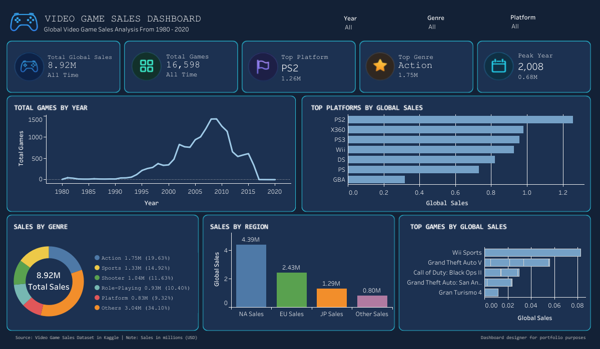

# Video Game Sales Analysis

**Python-Based Data Analysis & Tableau Dashboard | Global Video Game Sales**

## Overview

This portfolio project analyzes global video game sales data to uncover patterns across **genre, platform, publisher, and region**. It combines data cleaning, exploratory data analysis, statistical testing, and interactive visualization to generate actionable insights for game developers and publishers.

The goal is to understand historical market trends and provide data-driven recommendations for game development, platform selection, and regional market targeting.

## Executive Summary

The video game industry is highly concentrated, with a small number of publishers dominating global sales. Market performance is influenced by **genre preferences, platform selection, and regional differences**.

The analysis identifies **Action as the leading genre globally** and **Nintendo as a dominant publisher**. Regional platform preferences also vary significantly, indicating that a one-size-fits-all strategy may not be effective.

These findings highlight the importance of aligning **genre, platform, and regional market strategies** to support more informed business decisions.

## Business Objectives

- Identify the best-performing video game genres, platforms, and publishers.
- Compare video game sales performance across different geographic regions.
- Analyze historical trends in game releases and sales.
- Explore how genre preferences and platform selection relate to market performance.
- Translate analytical findings into business recommendations.

## Dataset

The dataset contains historical video game sales records, including game titles, platforms, release years, genres, publishers, and regional sales figures.

| Attribute | Description |
| --- | --- |
| Dataset | Video Game Sales |
| Source | Kaggle |
| Coverage | Historical global video game sales |
| Sales regions | North America, Europe, Japan, and Other Regions |
| Main dimensions | Genre, Platform, Publisher, Year |
| Sales measurement | Millions of units |

## Methodology

### 1. Data Preparation

Imported the video game sales dataset into Python and reviewed its structure, data types, and missing values.

### 2. Data Cleaning and Validation

- Handled missing values in the Year and Publisher columns.
- Removed incomplete records to improve data quality.
- Converted data types for accurate analysis.
- Validated dataset consistency and confirmed that no duplicate records were found.

### 3. Exploratory Data Analysis

- Analyzed sales distribution across genres, platforms, and regions.
- Identified top-performing publishers and game categories.
- Explored historical trends in game releases.
- Compared regional sales patterns.
- Used statistical testing to support the analysis.

### 4. Dashboard Reporting

Developed an interactive Tableau dashboard to visualize global video game sales performance across genres, platforms, publishers, and regions.

## Key Findings

- **Action** is the best-performing genre globally.
- **Nintendo** dominates the publisher landscape.
- Regional preferences differ significantly across geographic markets.
- Platform selection has a strong influence on sales performance.

These findings suggest that a uniform global strategy may be less effective than market-specific approaches to game development and distribution.

## Dashboard

**Tableau Dashboard:** [View Interactive Dashboard](https://public.tableau.com/app/profile/nabilah.putri.intaka1611/viz/VideoGameSalesDashboard_17376436610220/Dashboard?publish=yes)

  

The interactive dashboard provides an overview of global video game sales from 1980 to 2020, highlighting key trends across platforms, genres, and regions.

Users can explore top-performing games, leading platforms, and regional sales distribution to understand historical market dynamics.

## Business Recommendations

### Genre Strategy

Prioritize further market research into high-performing genres such as Action, Sports, and Shooter, while considering competition and audience demand.

### Regional Platform Strategy

Adapt platform selection to regional market characteristics instead of applying a uniform global distribution strategy.

### Market Segmentation

Use regional sales patterns to identify market opportunities and guide product positioning.

### Data-Driven Decision Making

Combine historical sales analysis with recent market data, consumer preferences, and development costs before making investment decisions.

## Tools and Technologies

| Tool | Purpose |
| --- | --- |
| Python | Data processing and analysis |
| Pandas & NumPy | Data manipulation and numerical operations |
| Matplotlib & Seaborn | Exploratory data visualization |
| SciPy | Statistical testing |
| Tableau | Interactive dashboard development |
| Jupyter Notebook | Analysis and documentation |

## Project Structure

- Data cleaning and exploratory analysis → Jupyter Notebook
- Statistical testing → Python and SciPy
- Data visualization → Matplotlib, Seaborn, and Tableau
- Business insights → Findings and recommendations

## How to Use

1. Access the dataset through the Kaggle source linked below.
2. Open the project's Jupyter Notebook to review data cleaning and exploratory analysis.
3. Review the statistical analysis and visualizations.
4. Explore the interactive Tableau dashboard using the link above.
5. Read the key findings and business recommendations.

## Limitations

- The dataset includes only games with sales above 100,000 copies, potentially excluding smaller and independent games.
- Historical data may not reflect recent developments in digital distribution and modern gaming platforms.
- The dataset does not include player behavior, marketing expenditure, or demographic information.
- The analysis focuses on historical data rather than predictive modeling.

## Future Improvements

- Develop predictive models to forecast video game sales.
- Perform deeper analysis of genre-platform combinations.
- Integrate additional datasets such as user reviews, ratings, and playtime.
- Analyze trends in modern platforms, including mobile gaming and digital distribution.

## Dataset Source

[Kaggle – Video Game Sales Dataset](https://www.kaggle.com/datasets/gregorut/videogamesales)

---

**Project:** Video Game Sales Analysis  
**Category:** Data Analytics / Exploratory Data Analysis  
**Tools:** Python, SciPy, Tableau  
**Dataset:** Historical Video Game Sales
